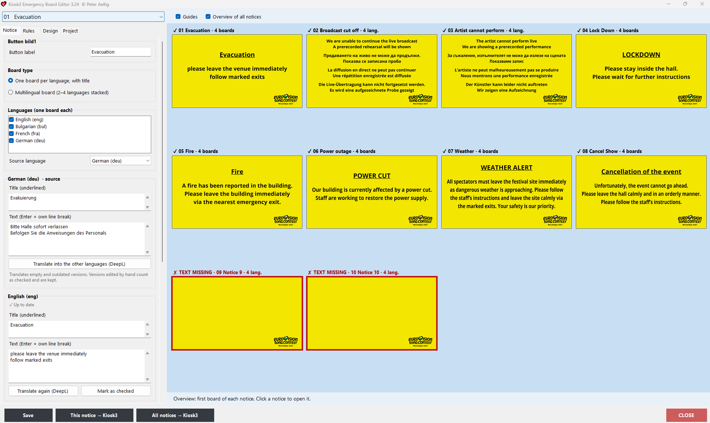

# Venue-Alert EvacScreen 3.24

Venue-Alert EvacScreen lets an event operator switch a venue screen between a live-input (OMT & NDI), sponsor loop, an announcement and prepared emergency slides. The remote shows a preview of the current output so the operator can confirm which message is on air. 
The small image on the Remote Screen is copy of the presentation screen and shows what the audience sees.
An editor is available for creating emergency slides. You select the necessary languages, specify the source language, and write the slides. DEEPL.COM then automatically translates the remaining slides at the click of a button. All you need is a free DEEPL Developer account and its API key. The editor is installed automatically, and an icon is placed on the desktop.
The LIVE video source has only a few ms additional latency, the encoding (H.264) of the signal for the browser takes only 3 ms.

## Download and first start

[Download the standard Windows x64 installer for Kiosk 3.24 (353 MB)](https://github.com/peteraellig/Venue-Alert-EvacScreen/releases/download/v3.24/Kiosk3_Setup_v3.24.exe)

This release provides the **standard installer**. It includes the kiosk application and example media. On a new PC, leave the dependency and Firefox options selected and connect to the internet during setup. Setup downloads the required components, including Python 3.12, its packages and the runtimes for OMT. After setup, the kiosk can operate on the local event network without internet access.

1. Run `Kiosk3_Setup_v3.24.exe` as administrator on the presentation PC. The default installation folder is `C:\kiosk3`.
   To edit emergency slides on this PC, select the **emergency board editor** and install the .NET 10 Desktop Runtime. With the editor and desktop icons selected, Setup creates two shortcuts: **Kiosk 3 Start** and **Kiosk 3 Board Editor**.
2. Launch **Kiosk 3 Start**. Firefox opens the presentation full screen. A Chrome launcher is also available for PCs with Chrome installed.
3. On the kiosk PC, open **http://localhost:53101/admin**. Set the initial admin password, sign in and set a remote-control password before connecting operators.
4. From the control desk, open `http://<kiosk-ip>:53101/remote` and sign in as `admin` with the remote password. For LAN access, allow the kiosk firewall rule during setup.

**Moving from 1.4.x?** Keep a copy of your existing media and button configuration. Kiosk 3 uses port **53101**. Update control-desk bookmarks and API calls, and check that each button points to the intended file or folder before going live.

## Operating the kiosk

| Interface | Use |
| --- | --- |
| Presentation · `/` | Full-screen output for the venue display. An optional OMT output can be configured in Admin. |
| Remote · `/remote` | Select an enabled program and check the on-air preview. Red buttons ask for a second tap. |
| Admin · `/admin` | Configure buttons, remote credentials, slideshow timing, sources, the nightly reset, Stream Deck input and API access. |
| API help · `/static/api_help.html` | View commands such as `/api?Function=bild1` and their media assignments. Configure the API switch and permitted addresses in Admin. |

A first installation includes prepared emergency slides in **bild1–bild8**. **bild9** and **bild10** are free slots for your own slides. Updating preserves existing emergency slides. Use **Kiosk 3 Board Editor** to prepare and export slides.

The installer includes four directly selectable videos (`video1.mp4` through `video4.mp4`) and two playlist clips (`AMB.mp4` and `go1080p25.mp4`).

Place videos in `static/videos`, playlist clips in `static/videos_playlist` and slideshow images in folders such as `static/bild1`. In **Admin → Slideshow timing**, each folder has one duration from **1 to 10 seconds per image** (default 3). Remote, Stream Deck and API selections use that same timing. A single image stays on screen.

Select **LIVE** as source, and then use the “source” option to choose one of the available OMT or NDI sources that appear. If no sources appear, it may be due to firewall settings, or there may be no IT video source available on the current network. For live use, an INTEL or NVIDIA graphics card is required, Intel CPU integrated graphics also work well. It also works with software encoders, but that requires a very powerful computer. We do not recommend software encoding. The live display latency is less than one frame.

Stream Deck input starts locked. Enable it in Admin or press the four corner keys together, then release them before repeating. On the Stream Deck Original, three corner keys can register as four and toggle the lock.

## Source and earlier documentation

The Python server, launcher, Stream Deck driver, web interfaces, C# emergency board editor and Inno Setup definition are included here. The source checkout includes sample media. The standard installer includes additional videos. To rebuild with the same media, copy the installed MP4 files to the corresponding source folders and compile [Installer/Kiosk3.iss](Installer/Kiosk3.iss) with Inno Setup 7.

The [archived 1.4.x manuals](https://github.com/peteraellig/Venue-Alert-EvacScreen/tree/57cd1a60663b1801028799fdd63ad99e0038df7b/Manual) document the previous version.

Project code is distributed under the [0BSD license](LICENSE). See the [third-party notices](licence/THIRD-PARTY-NOTICES.txt) for OMT.
